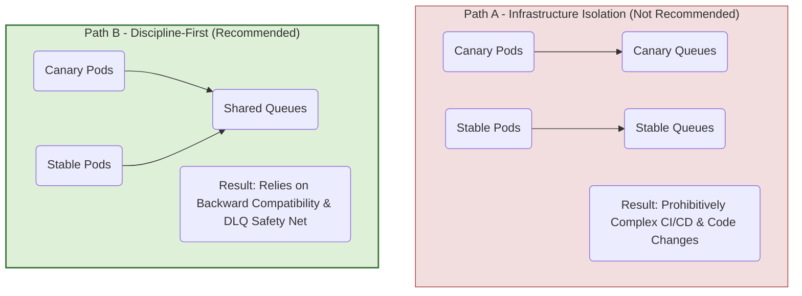

# Canary Strategy: Asynchronous Processing Challenges

This document details the core challenges of implementing canary deployments for a stateful, distributed monolith. It focuses specifically on the risks presented by asynchronous background jobs (Hangfire) and messaging (RabbitMQ), and outlines the recommended strategy to mitigate them.

---

### 1. The Central Challenge: Managing State in a Gradual Rollout

While the monolith is deployed as a single application, its architecture is distributed. It relies heavily on asynchronous background jobs (Hangfire) and messaging (RabbitMQ) to perform work. This means that even if a user's API request is handled by a "stable" pod, the resulting background work might be picked up by a "canary" pod, or vice-versa. This is the source of the core challenges for implementing canary deployments.

A canary deployment is straightforward for stateless services. For our stateful, distributed monolith, we face three key challenges that required investigation:

1.  **Background Jobs (Hangfire):** What happens if a canary pod enqueues a job? Can a stable pod process it correctly? What if a canary job has a bug and gets stuck?
2.  **Asynchronous Messaging (RabbitMQ):** How do we prevent a canary consumer from processing a stable message, or vice-versa? What happens if a new message format breaks an old consumer?
3.  **User Sessions & Routing:** How do we ensure a consistent user experience during testing? (This is a known challenge solvable with Istio's header-based routing and is not covered in the investigation below).

---

### 2. Investigation Findings & Evidence

This section summarizes the key takeaways from our deep-dive investigations into the codebase.

#### 2.1. Background Jobs (Hangfire): Mature and Resilient
*   The system uses a **"Database as Outbox"** pattern, which naturally decouples job creation from execution.
*   Jobs are overwhelmingly **idempotent** by design, meaning they are safe to be retried.
*   **Conclusion:** The job system is robust and poses a low risk for a shared-queue canary model.
*   *For full details, see: [`job_processing_investigation_summary.md`](./job_processing_investigation_summary.md)*

#### 2.2. Messaging (RabbitMQ / Rebus): Robust, with One Key Caveat
*   The system uses the **Rebus** framework, which provides a mature, automated **Dead-Letter Queue (DLQ)** safety net for handling message failures.
*   Publishing is centralized and reliable via a **"Transactional Outbox"** pattern.
*   **The Caveat:** While the majority (9 of 11) of message handlers are idempotent, a critical minority (2 of 11) that create financial records are **not**.
*   **Conclusion:** The messaging system's safety nets are strong. The non-idempotent handlers introduce a manageable risk of data duplication if a message is retried, which must be addressed with developer process.
*   *For full details, see: [`messaging_investigation_summary.md`](./messaging_investigation_summary.md)*

---

### 3. The Strategic Choice: Discipline vs. Complexity

Our investigation shows that the monolith's architecture is already well-aligned with one of the two primary canary strategies, making the choice clear.

*   **3.1. Path A: Infrastructure Isolation (Not Recommended)**
    *   **Description:** Create parallel "canary" queues for RabbitMQ and Hangfire.
    *   **Assessment:** This would be prohibitively complex, requiring invasive code changes and a massive CI/CD effort that doesn't align with our current architecture.

*   **3.2. Path B: Discipline-First (Recommended)**
    *   **Description:** Share the existing infrastructure. Rely on backward compatibility for all changes and leverage the existing DLQ and idempotency patterns as our safety net.
    *   **Assessment:** This is a low-complexity approach that aligns perfectly with our architecture's strengths. Our investigation shows the system is already 90% of the way there.

---

### 4. Proposed Implementation & Next Steps

To implement the "Discipline-First" strategy, we will proceed with the following steps:

1.  **Codify Developer Discipline:**
    *   Create and socialize a concise runbook for developing and deploying changes to message handlers and background jobs.
    *   The runbook's core mandate: **"All new asynchronous logic must be designed to be idempotent."**

2.  **Enhance Observability:**
    *   Build the Datadog dashboards and alerts to actively monitor the RabbitMQ error queues and the Hangfire "Failed" job count.

3.  **Implement Traffic Control:**
    *   Configure Istio `HTTPRoute` objects to enable header-based traffic shifting for internal and external testing.

4.  **Execute Pilot Canary Release:**
    *   Select a low-risk component that involves a change to a message handler or job.
    *   Execute a 1% -> 10% -> 50% -> 100% canary rollout, closely monitoring the new dashboards and the health of the system.
