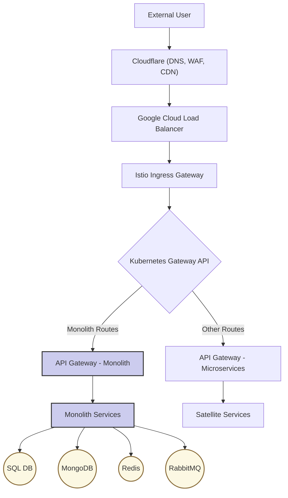
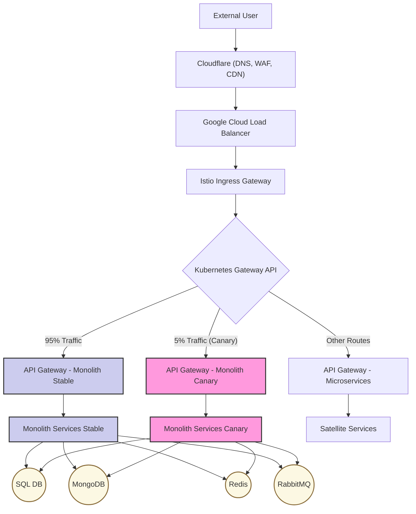
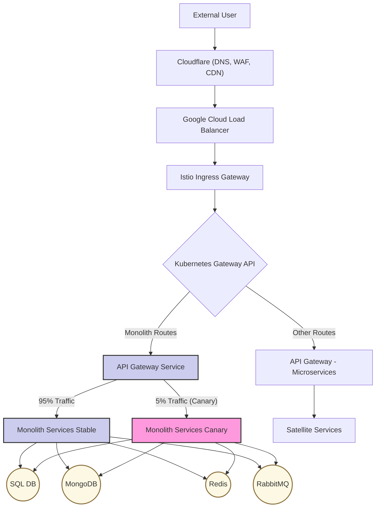

# Monolith Canary Deployment: Traffic Routing Options

This document provides a visual overview of the current monolith traffic flow and two potential strategies for implementing canary deployments by controlling traffic routing.

---

### **Recommendation**

**Option 1: Ingress-Level Traffic Splitting is the recommended approach.**

This strategy is preferred because it is a standard, well-understood industry pattern that cleanly separates infrastructure concerns (routing) from application concerns (business logic). It avoids adding complexity to the API Gateway and does not require the application to be aware of the deployment strategy.

---

### 1. As-Is: Current Traffic Flow

Currently, all traffic for the monolith is routed through a single path, with Kubernetes services directing requests to the available monolith pods. There is no mechanism for gradual rollout.

---

### 2. Option 1: Ingress-Level Traffic Splitting (Preferred)

In this model, the traffic split is handled at the infrastructure level, specifically by the Istio Ingress Gateway. The gateway is configured to route a small percentage of traffic to a separate "canary" deployment of the monolith.

*   **Pros:**
    *   **Application Agnostic:** The monolith application code does not need to be aware that it is part of a canary deployment.
    *   **Clean Separation:** The routing logic is handled by a dedicated infrastructure layer, keeping the application's concerns separate.
    *   **Standard Practice:** This is a very common and well-understood pattern for canary releases using service meshes like Istio.

*   **Cons:**
    *   **Infrastructure Complexity:** Requires configuration and management of Kubernetes/Istio `HTTPRoute` or similar custom resources.
    *   **Less Flexible:** Dynamic routing based on application-level data (e.g., user-specific flags) is more difficult to implement.

---

### 3. Option 2: API Gateway-Level Traffic Splitting

In this model, the Istio Ingress Gateway sends all monolith traffic to a single API Gateway service. The API Gateway itself is then responsible for splitting the traffic between the "stable" and "canary" monolith backends.

*   **Pros:**
    *   **Fine-Grained Control:** The API Gateway can use rich, application-level logic to make routing decisions (e.g., based on JWT claims, user roles, feature flags).
    *   **Centralized Logic:** All monolith routing logic is contained within the Gateway, which can simplify debugging from an application perspective.

*   **Cons:**
    *   **Application-Level Complexity:** The API Gateway becomes a more complex and critical component. A bug in its routing logic can affect the entire system.
    *   **Coupling:** The application is now tightly coupled to the deployment strategy. The Gateway must be explicitly aware of both stable and canary backends.
    *   **Potential Performance Overhead:** Adding this logic to the Gateway could introduce a small amount of latency to each request.
